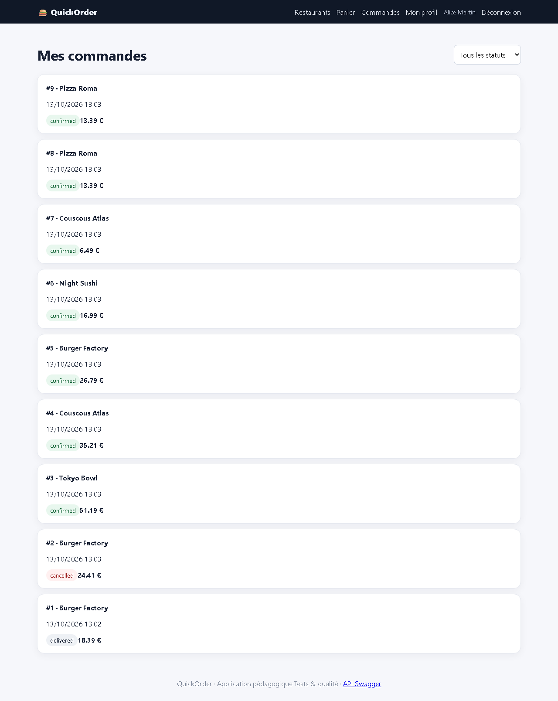

# BUG-01 — Un paiement PayPal crée deux commandes identiques et débite le stock deux fois

| Champ | Valeur |
|---|---|
| **Sévérité** | Bloquante |
| **Priorité** | P1 |
| **Zone** | Paiement / Checkout + API |
| **Cas de test** | TC-R05 |
| **Statut** | Ouvert — reproduit à chaque exécution de la campagne (base réinitialisée) |
| **Environnement** | QuickOrder V3.1 — Docker Compose (base réinitialisée par `docker compose down -v`), http://127.0.0.1:5000, Chromium (Playwright) 1280×900, Windows 11. |

## Contexte
Parcours de commande, paiement PayPal (UI /checkout et API POST /orders).

## Préconditions
Alice connectée ; panier : Margherita × 1 (Pizza Roma).

## Étapes de reproduction
1. Relever le nombre de commandes d'Alice : GET /api/orders → count = 7.
2. Ouvrir /checkout, choisir « PayPal — succès », cliquer « Confirmer 13.39 € ».
3. Ouvrir /orders ou relancer GET /api/orders.

## Résultat attendu
Une seule commande créée (+1), un seul paiement, stock décrémenté une fois.

## Résultat obtenu
Deux commandes #8 et #9 identiques (Pizza Roma, PayPal, 13,39 €, même horodatage à la milliseconde) ; count passe de 7 à 9. Le client est débité deux fois et le restaurant reçoit deux commandes.

## Preuves

- [`TC-R05.json`](../evidence/TC-R05.json)

## Analyse (cause probable dans le code)
`app/routes/orders.py` (checkout) et `app/routes/api.py` (create_order_api) : bloc `if payment == "paypal"` qui construit une seconde commande.
