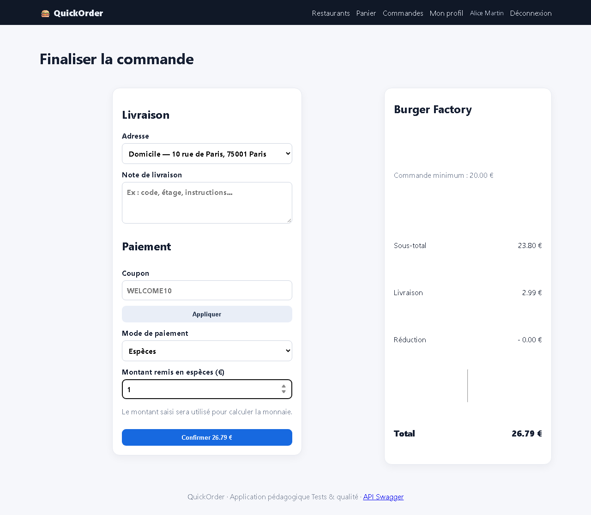
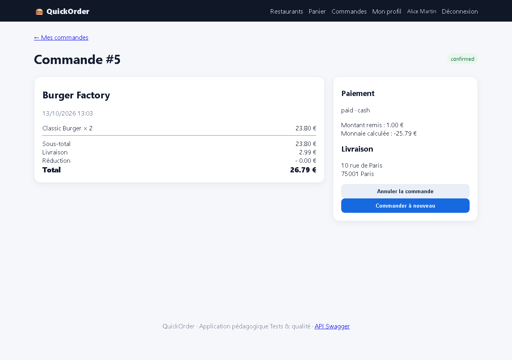

# BUG-02 — Paiement en espèces accepté avec un montant inférieur au total (rendu de monnaie négatif)

| Champ | Valeur |
|---|---|
| **Sévérité** | Critique |
| **Priorité** | P1 |
| **Zone** | Paiement espèces |
| **Cas de test** | TC-E08 |
| **Statut** | Ouvert — reproduit à chaque exécution de la campagne (base réinitialisée) |
| **Environnement** | QuickOrder V3.1 — Docker Compose (base réinitialisée par `docker compose down -v`), http://127.0.0.1:5000, Chromium (Playwright) 1280×900, Windows 11. |

## Contexte
Checkout, mode de paiement « Espèces ».

## Préconditions
Alice connectée ; panier Classic Burger × 2 (total 26,79 €).

## Étapes de reproduction
1. Ouvrir /checkout.
2. Choisir « Espèces », saisir 1 dans « Montant remis ».
3. Cliquer « Confirmer 26.79 € ».

## Résultat attendu
Commande refusée avec un message « Montant insuffisant » (montant remis ≥ total).

## Résultat obtenu
Commande #5 créée, statut confirmed, paiement « paid » ; montant remis 1,00 €, « Monnaie calculée : -25.79 € ». Requête réseau : `payment_method=cash&cash_received=1&confirm=1`.

## Preuves

- [`TC-E08_network.json`](../evidence/TC-E08_network.json)
- [`TC-E08.json`](../evidence/TC-E08.json)

## Analyse (cause probable dans le code)
`build_order()` (orders.py) et `create_order_api()` : `change_due` est calculé sans contrôle `cash_received >= total` ; `payment_ok` est toujours True.
