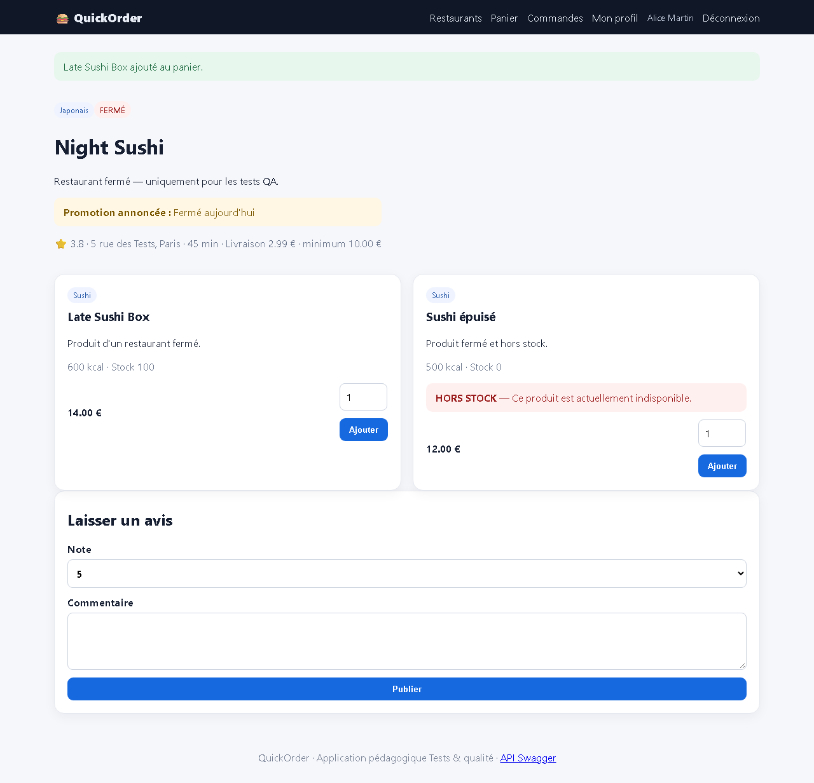
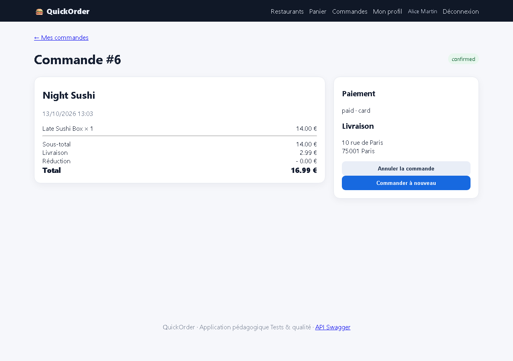

# BUG-03 — Commande possible dans un restaurant fermé (Night Sushi)

| Champ | Valeur |
|---|---|
| **Sévérité** | Critique |
| **Priorité** | P1 |
| **Zone** | Panier / Checkout |
| **Cas de test** | TC-R02 |
| **Statut** | Ouvert — reproduit à chaque exécution de la campagne (base réinitialisée) |
| **Environnement** | QuickOrder V3.1 — Docker Compose (base réinitialisée par `docker compose down -v`), http://127.0.0.1:5000, Chromium (Playwright) 1280×900, Windows 11. |

## Contexte
Restaurant Night Sushi affiché « FERMÉ » (is_open = false).

## Préconditions
Alice connectée, panier vide.

## Étapes de reproduction
1. Ouvrir /restaurant/6 (Night Sushi, badge FERMÉ).
2. Ajouter « Late Sushi Box ».
3. Aller au checkout et confirmer par carte.

## Résultat attendu
Ajout au panier ou validation refusé : « Ce restaurant est fermé ».

## Résultat obtenu
« Late Sushi Box ajouté au panier. » puis commande #6 créée au statut confirmed (16,99 €) pour un restaurant fermé.

## Preuves

## Analyse (cause probable dans le code)
`restaurant.is_open` n'est vérifié ni dans `shop.add`, ni dans `orders.checkout`, ni dans l'API.
