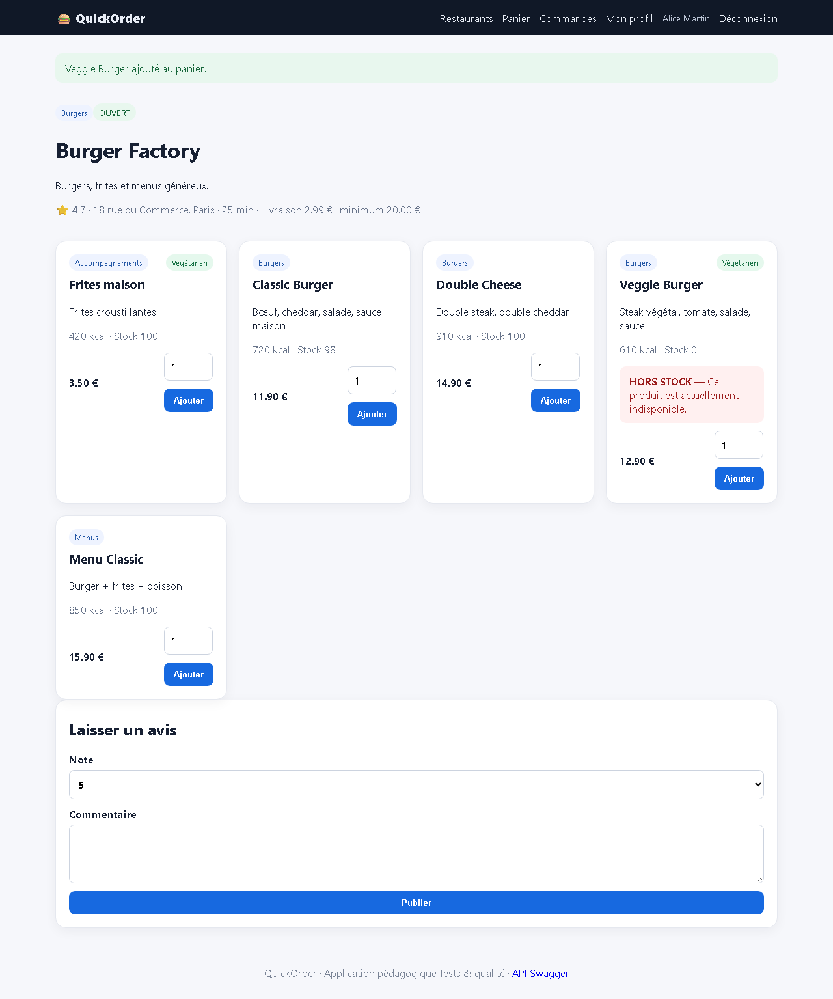
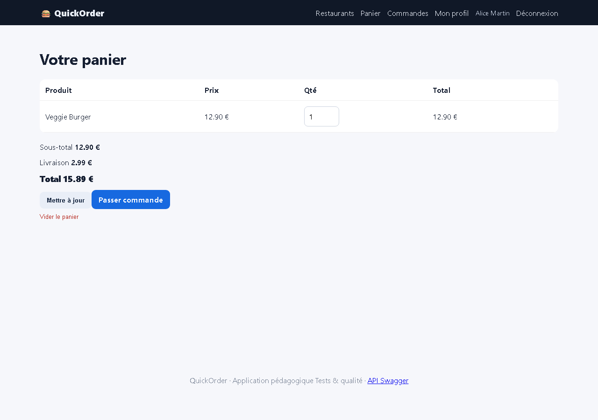
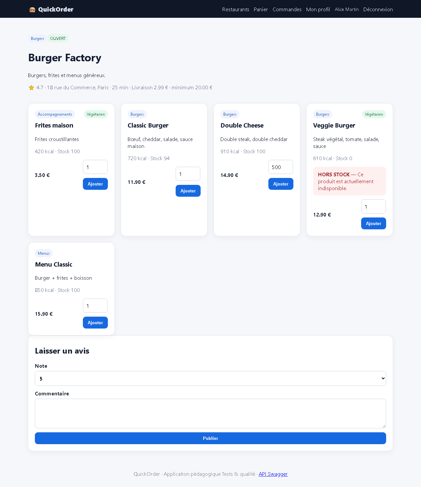
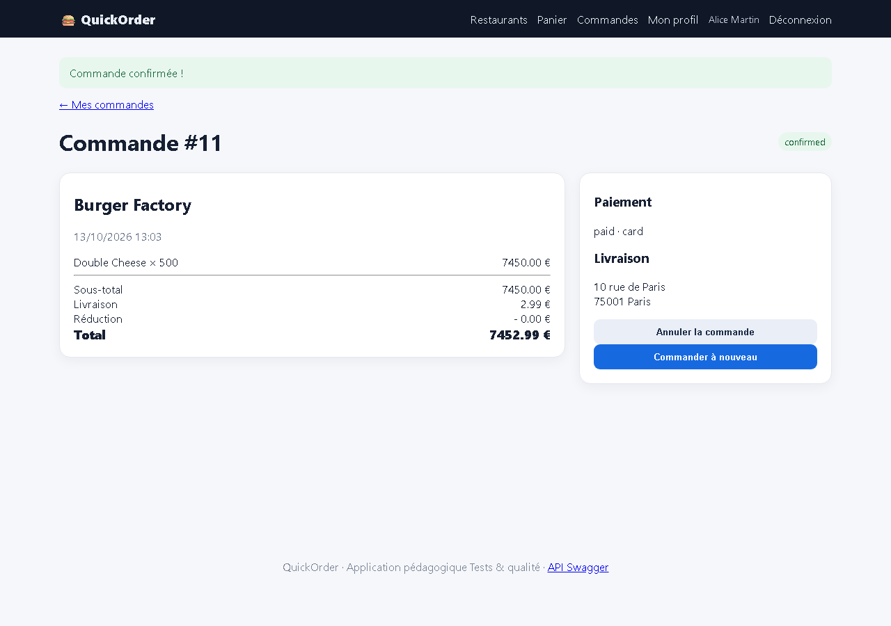

# BUG-05 — UI : produit « HORS STOCK » ajoutable au panier et quantité illimitée côté serveur (stock -400)

| Champ | Valeur |
|---|---|
| **Sévérité** | Critique |
| **Priorité** | P1 |
| **Zone** | UI / Panier / Stock |
| **Cas de test** | TC-L08, TC-L07 |
| **Statut** | Ouvert — reproduit à chaque exécution de la campagne (base réinitialisée) |
| **Environnement** | QuickOrder V3.1 — Docker Compose (base réinitialisée par `docker compose down -v`), http://127.0.0.1:5000, Chromium (Playwright) 1280×900, Windows 11. |

## Contexte
Page restaurant et panier (interface web).

## Préconditions
Alice connectée. Veggie Burger stock 0 ; Double Cheese stock 100.

## Étapes de reproduction
1. Ouvrir Burger Factory, cliquer « Ajouter » sur Veggie Burger (bandeau HORS STOCK).
2. Vider le panier. Dans DevTools, retirer l'attribut `max` du champ quantité de Double Cheese et saisir 500 (script : evidence/TC-L07_devtools.js).
3. Cliquer « Ajouter », puis commander par carte.
4. GET /api/products/2.

## Résultat attendu
Ajout refusé pour un produit à stock 0 ; quantité plafonnée au stock côté serveur ; stock jamais négatif.

## Résultat obtenu
« Veggie Burger ajouté au panier. » alors que le produit est affiché HORS STOCK ; le panier devient en plus impossible à mettre à jour (champ max=0, validation HTML bloquante). « Double Cheese ajouté au panier. » ×500 ; commande #11 créée ; stock 100 → -400.

## Preuves

- [`TC-L07.json`](../evidence/TC-L07.json)
- [`TC-L07_devtools.js`](../evidence/TC-L07_devtools.js)

## Analyse (cause probable dans le code)
`shop.add` ne vérifie que `product.available` ; `update_cart` et `add_order_items` ne contrôlent pas le stock (seul l'attribut HTML `max` limite la saisie).
