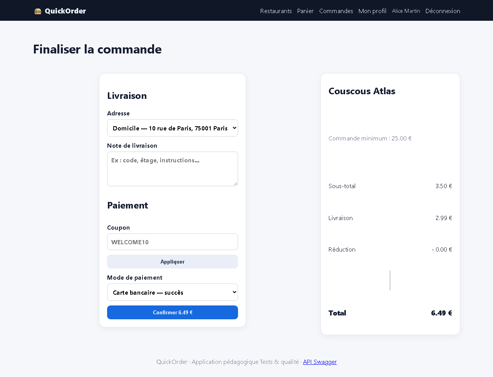
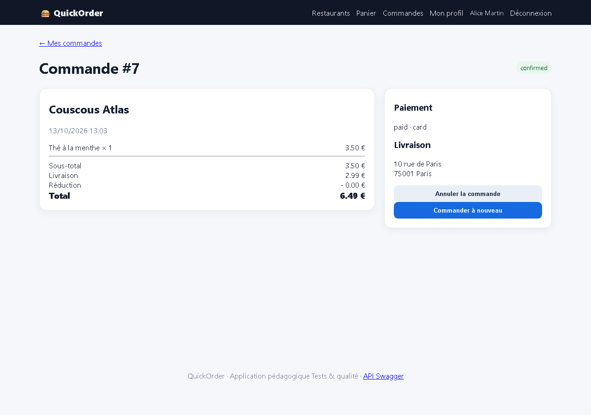

# BUG-06 — Le minimum de commande affiché n'est jamais appliqué

| Champ | Valeur |
|---|---|
| **Sévérité** | Majeure |
| **Priorité** | P1 |
| **Zone** | Checkout |
| **Cas de test** | TC-R03 |
| **Statut** | Ouvert — reproduit à chaque exécution de la campagne (base réinitialisée) |
| **Environnement** | QuickOrder V3.1 — Docker Compose (base réinitialisée par `docker compose down -v`), http://127.0.0.1:5000, Chromium (Playwright) 1280×900, Windows 11. |

## Contexte
Couscous Atlas : « minimum 25.00 € » affiché sur la fiche et au checkout.

## Préconditions
Alice connectée, panier vide.

## Étapes de reproduction
1. Ajouter « Thé à la menthe » × 1 (3,50 €) chez Couscous Atlas.
2. Ouvrir /checkout (affiche « Commande minimum : 25.00 € »).
3. Confirmer par carte.

## Résultat attendu
Commande refusée : « Minimum de 25,00 € non atteint ».

## Résultat obtenu
Commande #7 créée (confirmed) avec un sous-total de 3,50 €.

## Preuves

## Analyse (cause probable dans le code)
`restaurant.minimum_order` n'est utilisé que pour l'affichage (checkout UI et API).
