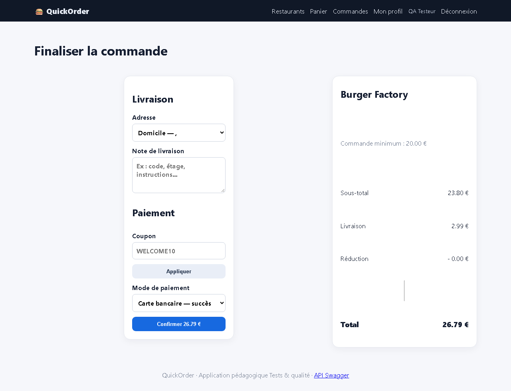
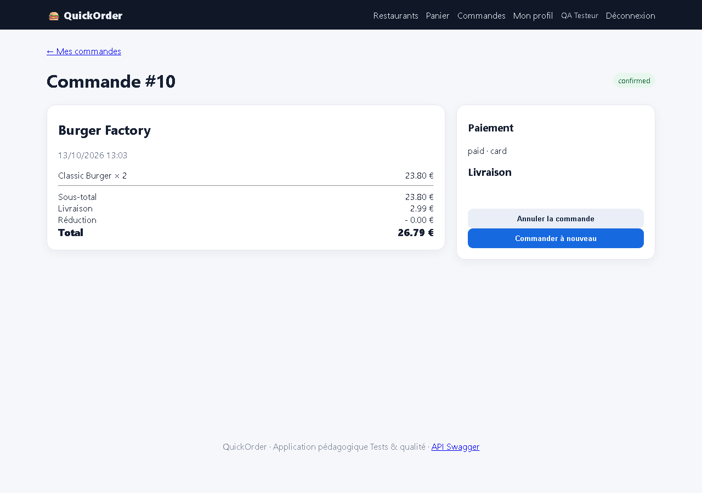

# BUG-07 — Un nouveau compte peut commander avec une adresse de livraison vide

| Champ | Valeur |
|---|---|
| **Sévérité** | Majeure |
| **Priorité** | P1 |
| **Zone** | Inscription / Checkout |
| **Cas de test** | TC-R11 |
| **Statut** | Ouvert — reproduit à chaque exécution de la campagne (base réinitialisée) |
| **Environnement** | QuickOrder V3.1 — Docker Compose (base réinitialisée par `docker compose down -v`), http://127.0.0.1:5000, Chromium (Playwright) 1280×900, Windows 11. |

## Contexte
Inscription puis première commande.

## Préconditions
Aucun.

## Étapes de reproduction
1. Créer un compte sur /register (nom, email, mot de passe).
2. Ajouter Classic Burger × 2.
3. Ouvrir /checkout : l'adresse proposée est « Domicile — , ».
4. Confirmer par carte.

## Résultat attendu
Le checkout exige une adresse complète (rue, code postal, ville) avant de valider.

## Résultat obtenu
Commande #10 créée (confirmed, payée) ; le bloc « Livraison » de la commande est vide.

## Preuves

## Analyse (cause probable dans le code)
`auth.register` crée une adresse par défaut avec street/postal_code/city vides ; `checkout` vérifie seulement que l'adresse appartient à l'utilisateur.
