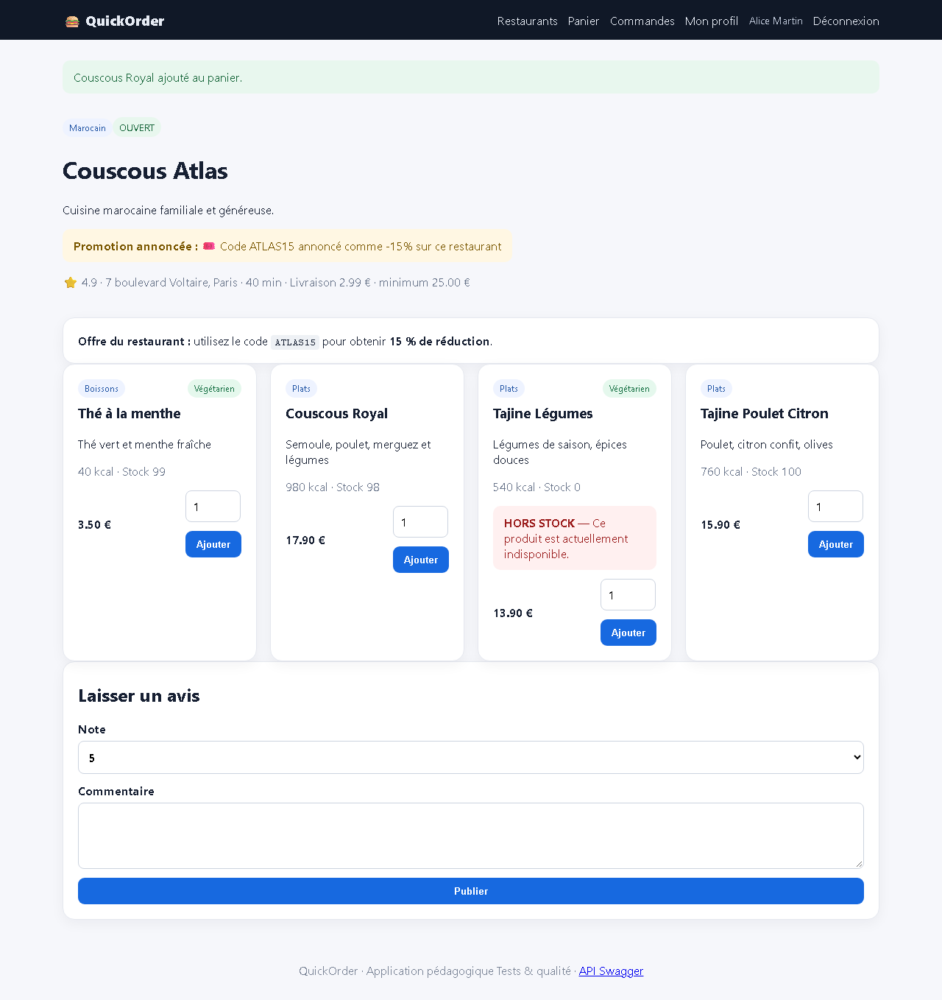
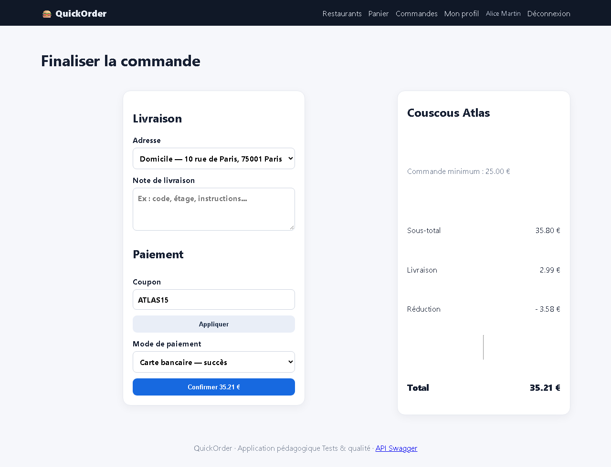

# BUG-08 — Le code ATLAS15 annoncé à -15 % n'applique que -10 %

| Champ | Valeur |
|---|---|
| **Sévérité** | Majeure |
| **Priorité** | P2 |
| **Zone** | Coupons / Promotions |
| **Cas de test** | TC-R04 |
| **Statut** | Ouvert — reproduit à chaque exécution de la campagne (base réinitialisée) |
| **Environnement** | QuickOrder V3.1 — Docker Compose (base réinitialisée par `docker compose down -v`), http://127.0.0.1:5000, Chromium (Playwright) 1280×900, Windows 11. |

## Contexte
Couscous Atlas affiche « utilisez le code ATLAS15 pour obtenir 15 % de réduction ».

## Préconditions
Alice connectée ; panier Couscous Royal × 2 (35,80 €).

## Étapes de reproduction
1. Ouvrir la fiche Couscous Atlas (promotion annoncée).
2. Ouvrir /checkout, saisir ATLAS15, cliquer « Appliquer ».

## Résultat attendu
Réduction de 15 % = 5,37 €.

## Résultat obtenu
Réduction de 3,58 € (10 %) ; total 35,21 € au lieu de 33,42 €. Publicité mensongère envers le client.

## Preuves

## Analyse (cause probable dans le code)
Donnée : coupon ATLAS15 enregistré avec discount_percent = 10 (seed.py).
