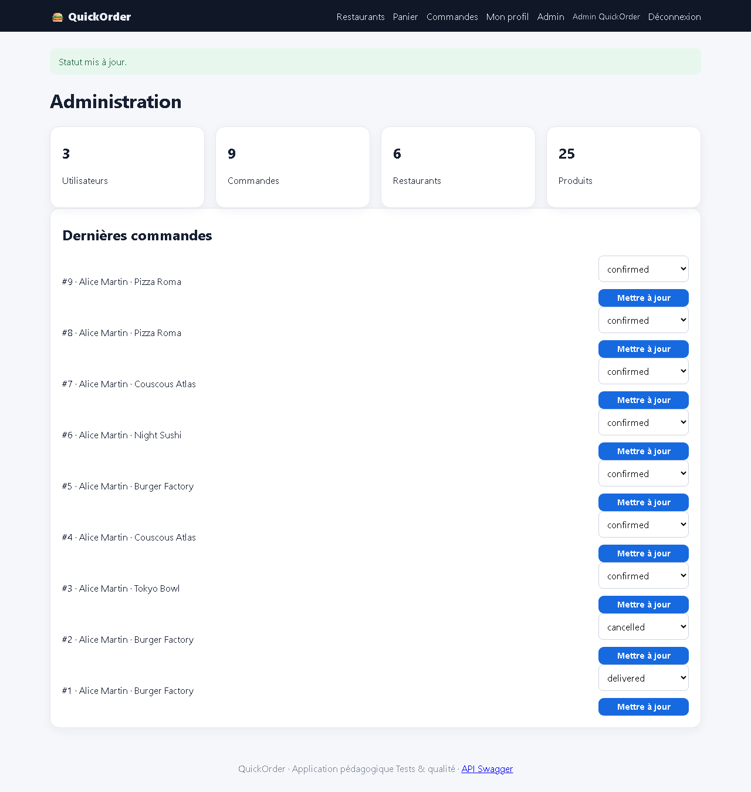

# BUG-10 — Admin : une commande livrée peut revenir au statut « confirmed »

| Champ | Valeur |
|---|---|
| **Sévérité** | Majeure |
| **Priorité** | P2 |
| **Zone** | Back-office admin |
| **Cas de test** | TC-R06 |
| **Statut** | Ouvert — reproduit à chaque exécution de la campagne (base réinitialisée) |
| **Environnement** | QuickOrder V3.1 — Docker Compose (base réinitialisée par `docker compose down -v`), http://127.0.0.1:5000, Chromium (Playwright) 1280×900, Windows 11. |

## Contexte
Tableau de bord /admin, mise à jour du statut d'une commande.

## Préconditions
Admin connecté ; commande #8 au statut confirmed.

## Étapes de reproduction
1. Passer la commande #8 à « delivered ».
2. Choisir « confirmed » et cliquer « Mettre à jour ».

## Résultat attendu
Transition refusée : le cycle de vie confirmed → preparing → out_for_delivery → delivered est à sens unique.

## Résultat obtenu
« Statut mis à jour. » ; la commande repasse de delivered à confirmed (vérifié par GET /api/orders/8). Elle redevient annulable par le client.

## Preuves

- [`TC-R06.json`](../evidence/TC-R06.json)

## Analyse (cause probable dans le code)
`admin.update_order_status` ne contrôle que l'appartenance à la liste des statuts, pas la transition.
