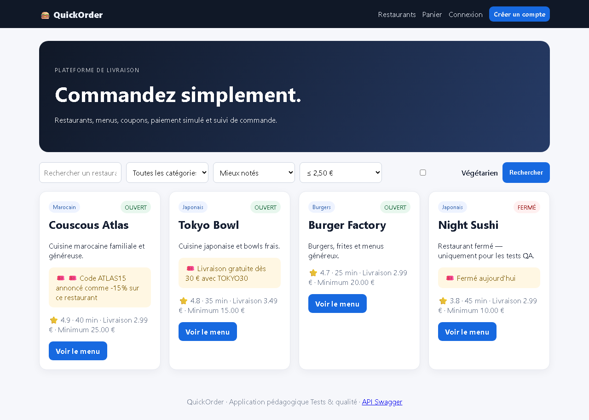

# BUG-12 — Le filtre « Livraison max » est inversé

| Champ | Valeur |
|---|---|
| **Sévérité** | Majeure |
| **Priorité** | P2 |
| **Zone** | Recherche / Filtres |
| **Cas de test** | TC-L01 |
| **Statut** | Ouvert — reproduit à chaque exécution de la campagne (base réinitialisée) |
| **Environnement** | QuickOrder V3.1 — Docker Compose (base réinitialisée par `docker compose down -v`), http://127.0.0.1:5000, Chromium (Playwright) 1280×900, Windows 11. |

## Contexte
Page d'accueil, filtre « Livraison max ≤ 2,50 € ».

## Préconditions
Aucun.

## Étapes de reproduction
1. Ouvrir /.
2. Choisir « ≤ 2,50 € » dans Livraison max, cliquer « Rechercher ».

## Résultat attendu
Green Kitchen (1,99 €) et Pizza Roma (2,49 €).

## Résultat obtenu
Couscous Atlas (2,99 €), Tokyo Bowl (3,49 €), Burger Factory (2,99 €), Night Sushi (2,99 €) : exactement les restaurants exclus.

## Preuves

## Analyse (cause probable dans le code)
`main.index` : `Restaurant.delivery_fee >= max_delivery` au lieu de `<=`.
