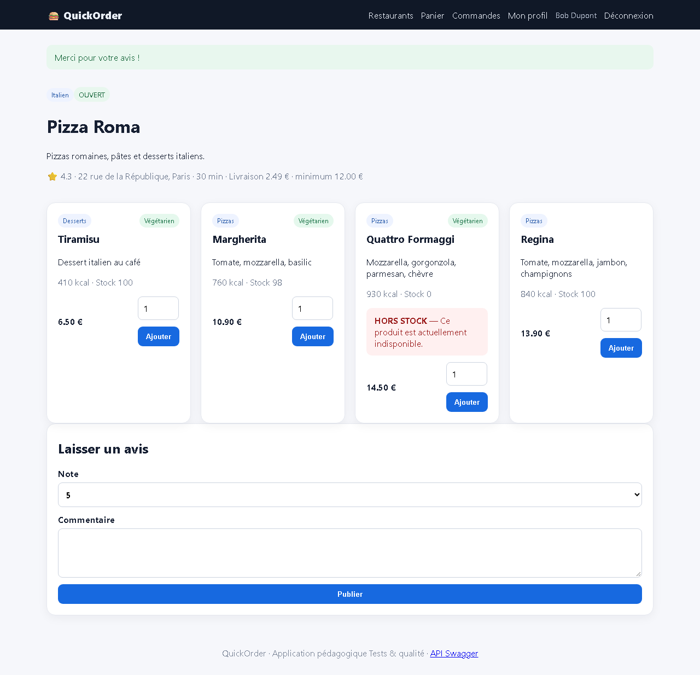

# BUG-13 — Un utilisateur peut publier un avis sur un restaurant où il n'a jamais commandé

| Champ | Valeur |
|---|---|
| **Sévérité** | Mineure |
| **Priorité** | P3 |
| **Zone** | Avis |
| **Cas de test** | TC-R07 |
| **Statut** | Ouvert — reproduit à chaque exécution de la campagne (base réinitialisée) |
| **Environnement** | QuickOrder V3.1 — Docker Compose (base réinitialisée par `docker compose down -v`), http://127.0.0.1:5000, Chromium (Playwright) 1280×900, Windows 11. |

## Contexte
Section « Laisser un avis » des fiches restaurant.

## Préconditions
Bob connecté, 0 commande.

## Étapes de reproduction
1. Ouvrir Pizza Roma.
2. Note 1, commentaire « Test QA : avis sans commande », cliquer « Publier ».

## Résultat attendu
Avis refusé : seuls les clients ayant une commande livrée peuvent noter.

## Résultat obtenu
« Merci pour votre avis ! » : l'avis est enregistré. Risque de faux avis / dénigrement.

## Preuves

## Analyse (cause probable dans le code)
`shop.review` n'exige aucune commande (order_id non renseigné).
