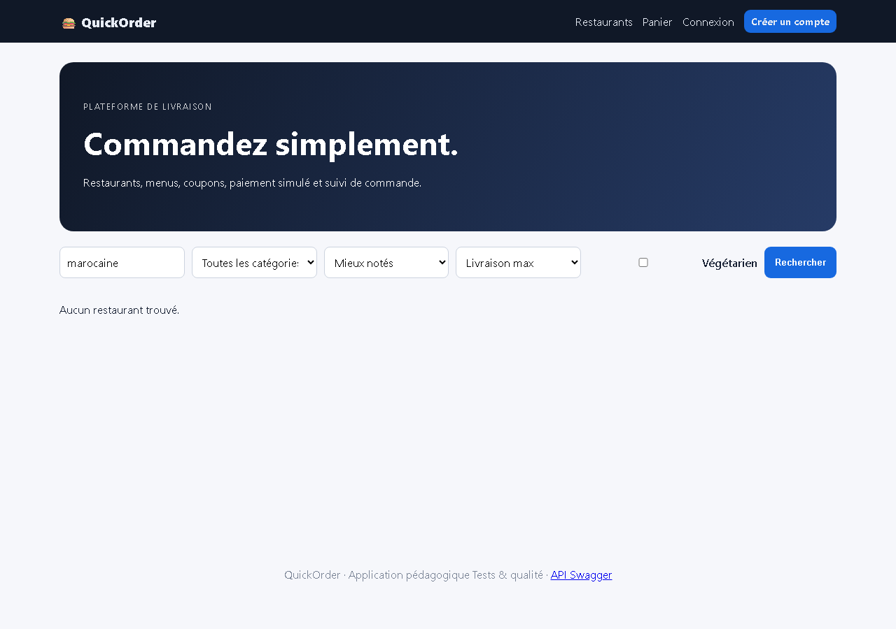

# BUG-14 — La recherche ignore la description des restaurants (UI et API)

| Champ | Valeur |
|---|---|
| **Sévérité** | Mineure |
| **Priorité** | P3 |
| **Zone** | Recherche |
| **Cas de test** | TC-R10 |
| **Statut** | Ouvert — reproduit à chaque exécution de la campagne (base réinitialisée) |
| **Environnement** | QuickOrder V3.1 — Docker Compose (base réinitialisée par `docker compose down -v`), http://127.0.0.1:5000, Chromium (Playwright) 1280×900, Windows 11. |

## Contexte
Recherche texte page d'accueil et GET /api/restaurants?q=.

## Préconditions
Couscous Atlas : description « Cuisine marocaine familiale et généreuse. »

## Étapes de reproduction
1. Rechercher « marocaine » sur /.
2. GET /api/restaurants?q=marocaine.

## Résultat attendu
Couscous Atlas est retourné.

## Résultat obtenu
UI : « Aucun restaurant trouvé. » ; API : count = 0.

## Preuves

- [`TC-R10.json`](../evidence/TC-R10.json)

## Analyse (cause probable dans le code)
Filtre `Restaurant.name.ilike(...)` uniquement (main.py et api.py).
