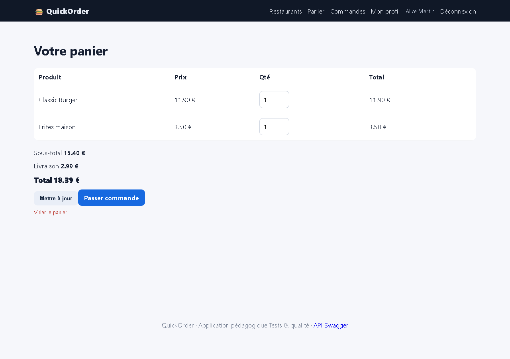

# BUG-15 — Aucun bouton pour supprimer un produit du panier

| Champ | Valeur |
|---|---|
| **Sévérité** | Mineure |
| **Priorité** | P3 |
| **Zone** | Panier |
| **Cas de test** | TC-N07 |
| **Statut** | Ouvert — reproduit à chaque exécution de la campagne (base réinitialisée) |
| **Environnement** | QuickOrder V3.1 — Docker Compose (base réinitialisée par `docker compose down -v`), http://127.0.0.1:5000, Chromium (Playwright) 1280×900, Windows 11. |

## Contexte
Page /cart (fonctionnalité annoncée « modification et suppression du panier »).

## Préconditions
Panier : Classic Burger × 1, Frites maison × 1.

## Étapes de reproduction
1. Ouvrir /cart.
2. Chercher une action « Supprimer » sur une ligne.

## Résultat attendu
Un bouton « Supprimer » par ligne (la route POST /cart/remove/<id> existe).

## Résultat obtenu
La dernière colonne contient un `<form></form>` vide imbriqué (HTML invalide) ; aucune action de suppression. Contournement : quantité 0 ou « Vider le panier ».

## Preuves

## Analyse (cause probable dans le code)
`templates/cart.html` : formulaire de suppression vide et imbriqué dans le formulaire de mise à jour.
